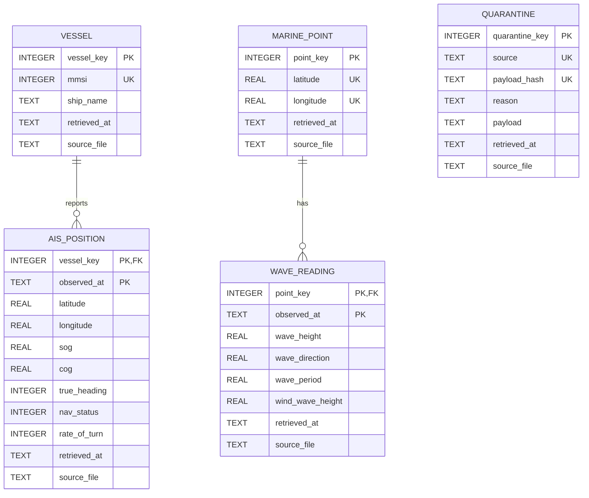

## Data Model (M2)

### ER diagram


### Grain of every table
- `vessel`: one row per vessel (MMSI).
- `marine_point`: one row per Open-Meteo wave-model grid cell (coordinates as returned by the API).
- `ais_position`: one row per AIS position report of one vessel at one timestamp (ms precision, UTC).
- `wave_reading`: one row per grid cell per UTC hour.
- `quarantine`: one row per distinct raw record (per source) that could not be loaded.

### Decisions and findings
**Keys.** Vessel = MMSI; event = (vessel_key, observed_at); wave point = (latitude, longitude) as
returned by the API (the API snaps our requested points to its grid, so we key on the *returned* cell);
wave event = (point_key, observed_at). Tested with `python src/key_tests.py` on the landed raw data:

| Key | Result |
|---|---|
| AIS (mmsi, observed_at) | 72 records, 72 distinct keys: unique |
| Same AIS key with different content | 0: a key always means the same thing |
| MMSI with more than one ship name | 0 of 67 vessels |
| AIS records without a usable key | 0 (nothing needed quarantine) |
| Marine points | 8 distinct (latitude, longitude) |
| Marine (point, time) | 960 distinct keys; 177 of them appear in several files with different values |

The 177 differing marine keys are not key violations: the same forecast hour is re-fetched in later files and
the model revises its values. The loader keeps the version from the most recently retrieved file.

**Missing values.** AIS: non-numeric/unparseable numbers -> NULL, counted in the run summary. AIS
"not available" sentinel codes (heading 511, SOG 102.3, lat 91 / lon 181) are stored *as received* (M3 decision).
Marine: JSON `null` = the model has no value for that cell/hour (e.g. points on land) -> stored as NULL,
**not zero**.

**Unknown references.** Entities are derived from the same record as the event (MMSI and coordinates
travel with every message), so an "unknown vessel" cannot occur. The equivalent failure is a record
*without a usable key* (no/invalid MMSI, unparseable `time_utc`, bad coordinates, broken JSON line): it goes to
`quarantine` verbatim, with a reason, deduplicated by hash: never dropped, never a crash. Structural problems
(a marine file that is not JSON, mismatched array lengths, non-UTC-stamp file names) abort the whole run and
roll everything back.

**Change over time.** Type 1. `vessel.ship_name` keeps the latest non-empty name (newest `retrieved_at`
wins; an empty name never overwrites a known one). The run summary reports how many names changed.
Grid points are immutable; a *new* point in a non-empty DB triggers a warning.

**Timestamps.** AIS `time_utc` (`2026-10-10 11:48:30.614308799 +0000 UTC`) -> `2026-10-10T11:48:30.614Z`
(nanoseconds truncated to ms). Marine times are requested in UTC and are converted explicitly using
`utc_offset_seconds` -> `2026-10-20T13:00Z`. Naive timestamps are quarantined, never guessed.

**Known issues.**
- ShipName is space-padded in the source (we trim it).
- AIS sentinel values (heading 511, SOG 102.3) are stored as received; cleaning is M3.
- Marine forecast hours are revised between fetches (latest fetch wins).
- The AIS sample is small (72 position reports from 67 vessels), so the analytical query rests on very few rows.
- No anchorage polygons yet: "waiting" currently means Sog < 0.5 kn near a wave point, not "inside an anchorage" (M3/M4).
- The data are 10-minute snapshots on a few days, so waiting duration cannot be measured reliably yet.
- Only the calm class (<= 1.5 m) appears in the result: no matched position fell in an hour with waves above 1.5 m.

### Analytical query
`sql/queries/wave_vs_speed.sql`: share of waiting vessels (Sog < 0.5 kn) and average speed by nearest wave
point and wave-height class (<= 1.5 m, 1.5-2.5 m, > 2.5 m).
Result grain: one row per (marine_point, wave class). Each AIS position is matched to its nearest wave point and
its own UTC hour, so it is counted at most once.

```
point_lat  point_lon  wave_class         n_positions  avg_sog_knots  n_waiting  pct_waiting
---------  ---------  -----------------  -----------  -------------  ---------  -----------
40.958336  28.958344  1 calm (<= 1.5 m)  1            11.7           0          0.0
41.375     29.208344  1 calm (<= 1.5 m)  3            6.93           1          33.3
```

### How to build the database
```bash
pip install -r requirements.txt        # requests, websocket-client, python-dotenv
python src/ingest.py                   # M1: land raw data (skip if data/raw already exists)
python src/load.py                     # builds data/maritime.db from scratch; running again changes nothing
python src/key_tests.py                # key evidence (section above)
python src/checks.py                   # six checks on a temporary copy
```
The database file is git-ignored (`data/*.db`); anyone with the raw data can rebuild it with `python src/load.py`.

### Status
M2 - schema and load complete.