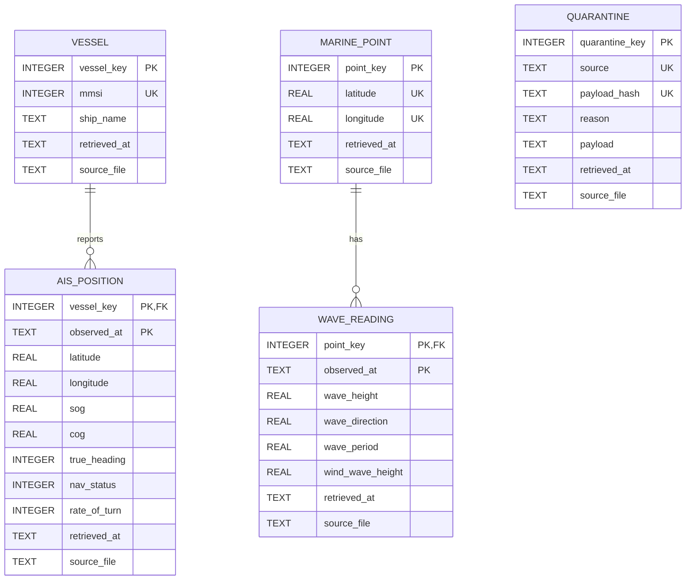

## Data Model (M2)

### ER diagram


### Grain of every table
- `vessel`: one row per vessel (MMSI).
- `marine_point`: one row per Open-Meteo wave-model grid cell (coordinates as returned by the API).
- `ais_position`: one row per AIS position report of one vessel at one timestamp (ms precision, UTC).
- `wave_reading`: one row per grid cell per UTC hour.
- `quarantine`: one row per distinct raw record (per source) that could not be loaded.

### Decisions and findings
**Keys.** Vessel = MMSI; event = (vessel_key, observed_at); wave point = (latitude, longitude) as
returned by the API (the API snaps our requested points to its grid, so we key on the *returned* cell);
wave event = (point_key, observed_at). Tested with `python src/key_tests.py` on the landed raw data:

| Key | Result |
|---|---|
| AIS (mmsi, observed_at) | 72 records, 72 distinct keys: unique |
| Same AIS key with different content | 0: a key always means the same thing |
| MMSI with more than one ship name | 0 of 67 vessels |
| AIS records without a usable key | 0 (nothing needed quarantine) |
| Marine points | 8 distinct (latitude, longitude) |
| Marine (point, time) | 960 distinct keys; 177 of them appear in several files with different values |

The 177 differing marine keys are not key violations: the same forecast hour is re-fetched in later files and
the model revises its values. The loader keeps the version from the most recently retrieved file.

**Missing values.** AIS: non-numeric/unparseable numbers -> NULL, counted in the run summary. AIS
"not available" sentinel codes (heading 511, SOG 102.3, lat 91 / lon 181) are stored *as received* (M3 decision).
Marine: JSON `null` = the model has no value for that cell/hour (e.g. points on land) -> stored as NULL,
**not zero**.

**Unknown references.** Entities are derived from the same record as the event (MMSI and coordinates
travel with every message), so an "unknown vessel" cannot occur. The equivalent failure is a record
*without a usable key* (no/invalid MMSI, unparseable `time_utc`, bad coordinates, broken JSON line): it goes to
`quarantine` verbatim, with a reason, deduplicated by hash: never dropped, never a crash. Structural problems
(a marine file that is not JSON, mismatched array lengths, non-UTC-stamp file names) abort the whole run and
roll everything back.

**Change over time.** Type 1. `vessel.ship_name` keeps the latest non-empty name (newest `retrieved_at`
wins; an empty name never overwrites a known one). The run summary reports how many names changed.
Grid points are immutable; a *new* point in a non-empty DB triggers a warning.

**Timestamps.** AIS `time_utc` (`2026-10-10 11:48:30.614308799 +0000 UTC`) -> `2026-10-10T11:48:30.614Z`
(nanoseconds truncated to ms). Marine times are requested in UTC and are converted explicitly using
`utc_offset_seconds` -> `2026-10-20T13:00Z`. Naive timestamps are quarantined, never guessed.

**Known issues.**
- ShipName is space-padded in the source (we trim it).
- AIS sentinel values (heading 511, SOG 102.3) are stored as received; cleaning is M3.
- Marine forecast hours are revised between fetches (latest fetch wins).
- The AIS sample is small (72 position reports from 67 vessels), so the analytical query rests on very few rows.
- No anchorage polygons yet: "waiting" currently means Sog < 0.5 kn near a wave point, not "inside an anchorage" (M3/M4).
- The data are 10-minute snapshots on a few days, so waiting duration cannot be measured reliably yet.
- Only the calm class (<= 1.5 m) appears in the result: no matched position fell in an hour with waves above 1.5 m.

### Analytical query
`sql/queries/wave_vs_speed.sql`: share of waiting vessels (Sog < 0.5 kn) and average speed by nearest wave
point and wave-height class (<= 1.5 m, 1.5-2.5 m, > 2.5 m).
Result grain: one row per (marine_point, wave class). Each AIS position is matched to its nearest wave point and
its own UTC hour, so it is counted at most once.

```
point_lat  point_lon  wave_class         n_positions  avg_sog_knots  n_waiting  pct_waiting
---------  ---------  -----------------  -----------  -------------  ---------  -----------
40.958336  28.958344  1 calm (<= 1.5 m)  1            11.7           0          0.0
41.375     29.208344  1 calm (<= 1.5 m)  4            7.65           1          25.0
```
(M3 revision: the query reads `ais_position_clean` and corrects the east-west distance. The correction
brings one more position into the 0.5 degree radius of point 41.375/29.208: 3 positions before, 4 now.)

### How to build the database
```bash
pip install -r requirements.txt        # requests, websocket-client, python-dotenv
python src/ingest.py                   # M1: land raw data (skip if data/raw already exists)
python src/load.py                     # builds data/maritime.db from scratch; running again changes nothing
python src/key_tests.py                # key evidence (section above)
python src/checks.py                   # six M2 checks on a temporary copy
python src/checks_m3.py                # M3 checks (cleaning, anchorage polygons, queries)
python src/clean_report.py             # M3 report: cleaning log, anchorage counts, both queries
```
The database file is git-ignored (`data/*.db`); anyone with the raw data can rebuild it with `python src/load.py`.

## Cleaning and anchorages (M3)

### Principle
The raw table `ais_position` is never modified. All cleaning is in the view `ais_position_clean`
(`sql/clean.sql`), so each rule is visible, countable and reversible. `load.py` creates the views
and tables on every run (`db.init_schema` now runs `schema.sql`, `clean.sql`, `anchorage.sql`).

### Cleaning rules
| Column | Raw "not available" / invalid | Clean value |
|---|---|---|
| `sog` | 102.3, or outside 0..102.2 | NULL |
| `cog` | 360, or outside 0..359.9 | NULL |
| `true_heading` | 511, or outside 0..359 | NULL |
| `nav_status` | 15 (undefined), or outside 0..14 | NULL |
| `rate_of_turn` | -128, or outside -127..127 | NULL |
| `latitude`, `longitude` | lat 91 / lon 181, out of range, (0, 0) | NULL, `position_valid = 0` |

NULL means "unknown", never zero. A row with an invalid position is kept (its Sog is still usable)
but is excluded from every spatial join. The view `cleaning_log` reports how many raw rows each rule
changed; `python src/clean_report.py` prints it.

### Anchorages
Tables `anchorage` (one row per anchorage) and `anchorage_vertex` (one row per polygon corner, ordered
by `seq`). The polygons in `sql/anchorage.sql` are **approximate placeholder boxes** around our wave points
and must be replaced with official coordinates. Point-in-polygon is ray casting in SQL (view
`ais_in_anchorage`, grain: position x anchorage). Each anchorage gets exactly one wave point, the
nearest to its centroid (view `anchorage_wave_point`), so the wave join cannot fan out.

### Queries
- `sql/queries/wave_vs_speed_anchorage.sql`: waiting share (Sog < 0.5 kn) and average speed per
  (anchorage, wave class), only for positions **inside** an anchorage polygon.
- `sql/queries/wave_vs_speed.sql` (M2 query, revised): reads the clean view; the `sog < 102.3`
  filter moved out of the query; the distance now scales longitude by cos(40 deg)^2 = 0.587.

### Results on the real database (72 positions, 67 vessels)
Cleaning log (raw rows changed per rule):

| Rule | Rows | Share of 72 |
|---|---|---|
| `sog` 102.3 / out of range | 0 | 0% |
| `cog` 360 / out of range | 11 | 15% |
| `true_heading` 511 / out of range | 20 | 28% |
| `nav_status` 15 / out of range | 3 | 4% |
| `rate_of_turn` -128 / out of range | 20 | 28% |
| invalid position (lat 91, lon 181, (0,0), NULL) | 0 | 0% |

Every anchorage found a wave point (squared distance 0.001 to 0.039 degree^2, limit 0.25), and no position
lies in two anchorages. Only 1 of 72 positions (1 vessel) lies inside an anchorage polygon (Bosphorus North).

Anchorage query result:

```
anchorage                             wave_class         n_positions  n_vessels  avg_sog_knots  n_waiting  pct_waiting
------------------------------------  -----------------  -----------  ---------  -------------  ---------  -----------
Bosphorus North (Black Sea entrance)  1 calm (<= 1.5 m)  1            1          9.9            0          0.0
```
This is one position in the calm class: it shows that the pipeline works end to end, but it is
**not evidence** about waves and waiting. Rough (1.5-2.5 m) and severe (> 2.5 m) classes are still empty.

### Checks (`python src/checks_m3.py`)
Synthetic raw files in a temporary database: sentinels become NULL, valid values survive, the raw
table is untouched, invalid positions are flagged, cleaning_log counts match, point-in-polygon
(inside / outside), no overlapping polygons, hand-computed result of the anchorage query,
idempotent reload (digest of every table, including the anchorage tables).

### Known limits (M3)
- Anchorage polygons are placeholders until replaced with official ones.
- "Waiting" is still a snapshot (Sog < 0.5 kn at one timestamp). With ~10-minute snapshots on a few days,
  waiting *duration* is not measurable. More ingest runs (storm days, longer collection) are needed.
- The sample is small (1 position inside an anchorage, none in an hour above 1.5 m): the wave effect cannot be concluded
  until more data with rough sea state is collected.
- Wave point to anchorage assignment uses the nearest point within ~0.5 degree; far anchorages get none
  (they simply produce no rows).

### Status
M3 - cleaning layer and anchorage model complete and run on the real database (see results above).