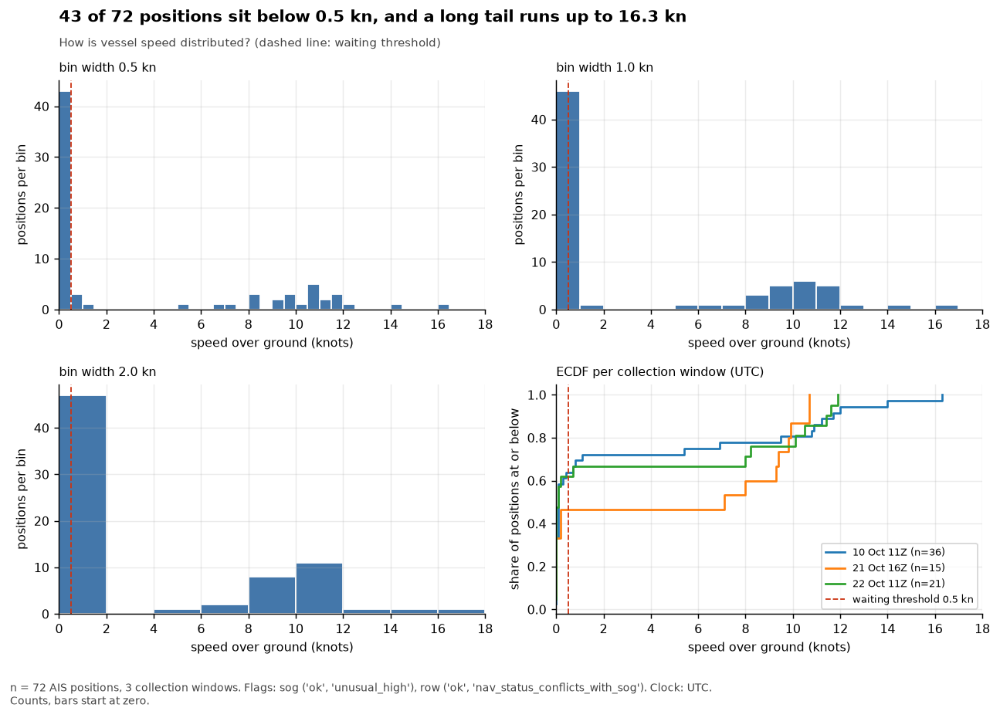
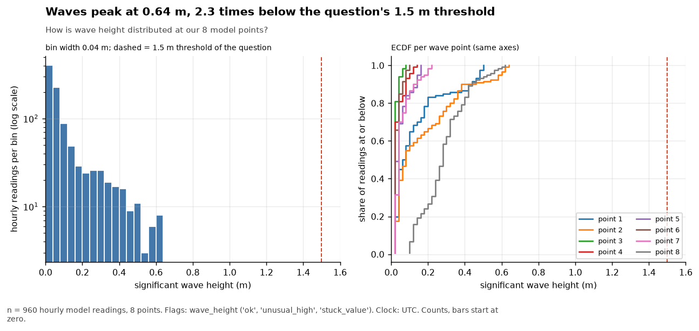
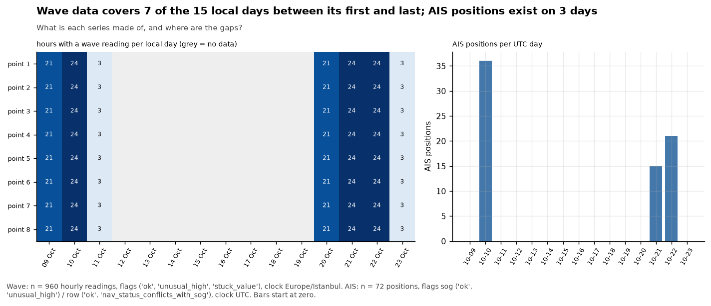
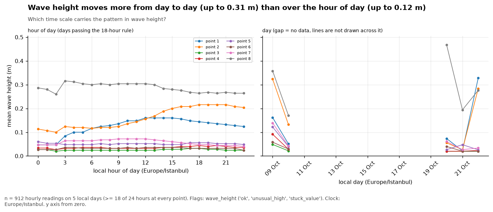
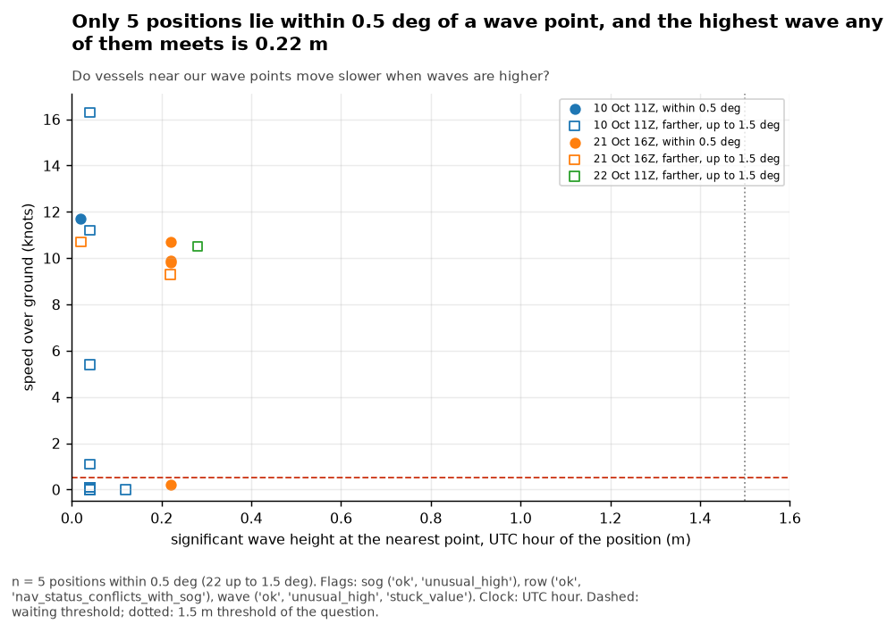
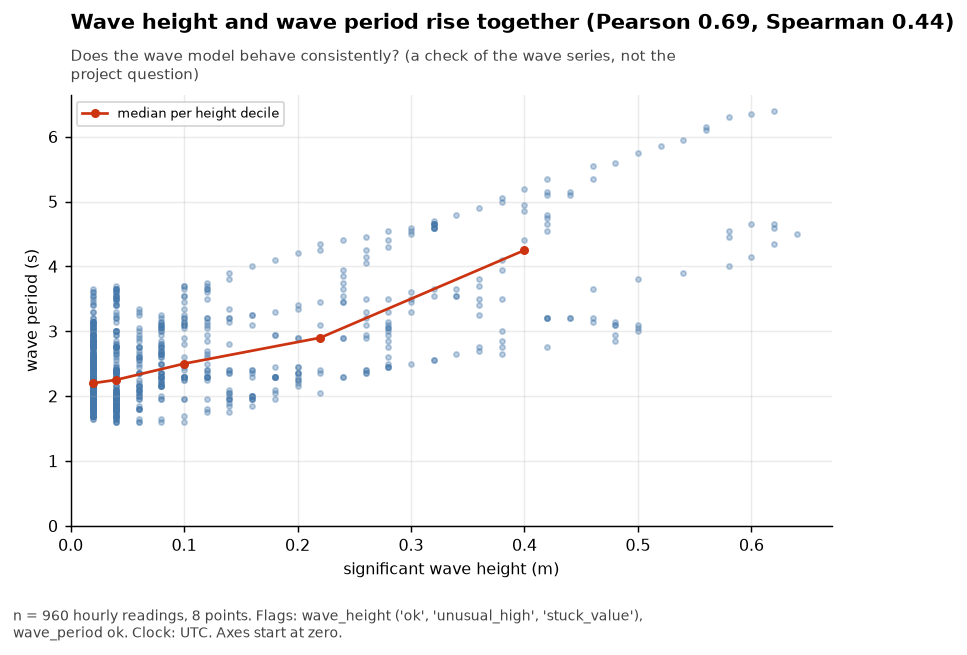
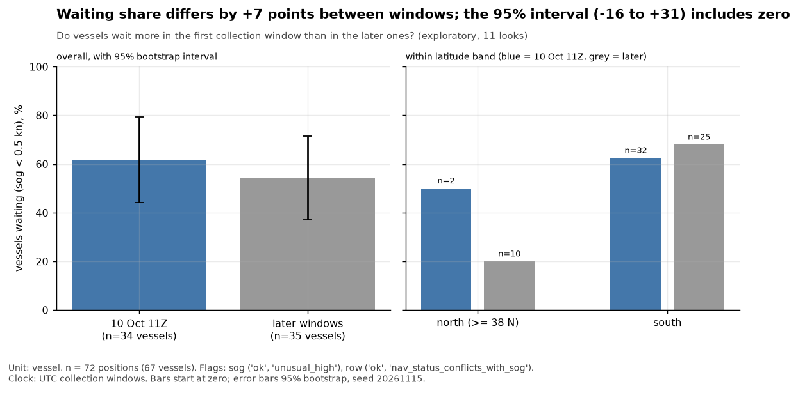

# Exploratory Analysis: Turkish Straits maritime pipeline

Project question: **when the sea is rougher, do vessels near our wave points slow down, and does the share of waiting vessels (sog below 0.5 kn) grow?**
Everything below is computed by `notebooks/m4_eda.ipynb` (run on a fresh `load.py` + `clean.py` build, read-only connection, figures written to `figures/`).
Flag filter used unless stated: AIS `sog_flag` in (ok, unusual_high), `row_flag` in (ok, nav_status_conflicts_with_sog), `wave_height_flag` in (ok, unusual_high, stuck_value).

## 1. Summary
The data cannot answer the project question yet, and exploration shows exactly why. The highest wave in the whole sample is 0.64 m; the question asks about 1.5 m and 2.5 m, and 0 of 960 hourly readings exceed 1.0 m. Only 5 of 72 AIS positions lie within 0.5 degrees of a wave point, and the waves those five meet are 0.02 m and 0.22 m. Vessel speed is two groups (43 of 72 positions below 0.5 kn, the others mostly between 8 and 12 kn), so the share of waiting positions is a better summary than the mean. The one comparison we could make, waiting share on 10 Oct against the later windows, is +7.5 percentage points with a 95% interval of -15.9 to +30.6, so it shows no difference we can trust. Exploration found no error in the cleaned layer, so nothing changed in `clean.py` and no M3 issue was reopened (M3 issues fixed since the M3 tag: none). The main thing that would change the picture is data from a rough-sea period collected with an AIS area that actually contains the wave points.

## 2. Raw versus cleaned
Key number: share of AIS positions waiting (sog < 0.5 kn) among positions whose nearest wave point is within 0.5 degrees, in an hour with a wave reading. Queries: `sql/queries/m4_key_raw.sql` (M2 tables, no flag filter) and `sql/queries/m4_key_clean.sql` (cleaned layer, flags above).

| Version | positions | waiting | share waiting | mean sog (kn) |
|---|---|---|---|---|
| Raw (M2 tables, no filter) | 5 | 1 | 20.0% | 8.46 |
| Cleaned (flag filter above) | 5 | 1 | 20.0% | 8.46 |

Cleaning changed nothing for this number, and that is a result: the sample has 0 `sog` sentinel values (102.3) and 0 invalid coordinates (M3 checks), and the one conflicting `nav_status` row is kept. Cleaning did change other numbers. The mean `true_heading` is 287.8 on 72 raw rows and 202.0 on the 52 rows with a real heading (20 rows carry the 511 "not available" code; heading is circular, so this mean is only an illustration of the effect). The mean wave height is 0.0984 m both ways, because no value is NULL and the unusual or stuck values are kept.

## 3. The question and its summary
The question is about a rate (how many vessels wait), so the summary is the **share of positions below 0.5 kn**, with n. A mean speed would hide that vessels are either standing or moving. For comparison we computed the median, mean and 90th percentile of `sog`.

| Collection window (UTC) | n | share waiting | mean (kn) | median (kn) | p90 (kn) |
|---|---|---|---|---|---|
| 10 Oct 11Z (Saturday 14:48 local) | 36 | 63.9% | 3.14 | 0.1 | 11.45 |
| 21 Oct 16Z (Wednesday 19:11 local) | 15 | 46.7% | 5.02 | 7.1 | 10.38 |
| 22 Oct 11Z (Thursday 14:37 local) | 21 | 61.9% | 3.47 | 0.1 | 11.40 |

Ranked slowest first, the share waiting, the median and the mean give the same order (10 Oct, 22 Oct, 21 Oct). The 90th percentile reverses it (21 Oct, 22 Oct, 10 Oct). These answer different questions: the share waiting says how many vessels stand still, the p90 says how fast the fastest tenth are. On 21 Oct fewer vessels wait, but its fast vessels are not faster than on 10 Oct.
Group by wave point (matched positions only): point 7 has 1 position, point 8 has 4 (25% waiting). Both are below our 10-position rule, so we report no share for them.

## 4. What the data is made of
**Shape.** 
Speed has two modes: a spike at zero (43 of 72 positions below 0.5 kn; the first bin holds 60%, 64% and 65% of positions at bin widths 0.5, 1 and 2 kn) and a hump at 8 to 12 kn, up to 16.3 kn. Almost nothing lies between 2 and 5 kn, which is exactly where the mean falls, so the mean describes no vessel. The ECDFs per window show the same two-step shape in all three windows.

Wave height is strongly right-skewed on a 0.02 m grid (bin widths 0.02, 0.04 and 0.1 m tried; 0.04 m shown, log scale). The maximum is 0.64 m and the 1.5 m threshold of the question lies far outside the data. Points 3 to 7 stay below about 0.22 m; points 1, 2 and 8 are higher, and point 8 never goes below 0.1 m.

**Coverage.** 

| Series | Coverage |
|---|---|
| Wave readings | 8 points x 5 UTC days (9, 10, 20, 21, 22 Oct), 24 of 24 hours each; nothing from 11 to 19 Oct |
| AIS positions | 72 positions, 3 collection windows of about 10 minutes (36, 15, 21); 62 vessels have 1 position, 5 have 2 |
| AIS near a wave point (nearest point within the radius) | 0.5 deg (about 56 km): 5 positions; 1.0 deg: 8; 1.5 deg: 22 |

Coverage rules. (1) A local-day wave mean needs at least 18 of 24 hours, because a 3-hour fragment can sit entirely inside one weather episode. In local time, 11 and 23 Oct have only 3 hours and are dropped; 9 and 20 Oct have 21 hours and stay. Without the rule, the mean of daily means is 0.157 m (point 1), 0.207 m (point 2) and 0.272 m (point 8); with it, 0.127, 0.164 and 0.293 m. The 3-hour fragment at the end of the data holds the high waves of the evening of 22 Oct, so applying the rule lowers the means of points 1 and 2 by 19% and 21%. (2) A share over a group of positions needs at least 10 positions; this removes both wave-point groups of section 3.
Flag filter. The key number is identical with the main filter and with ok-only (5 positions, 20.0%, 8.46 kn). The mean wave height is not: 0.0834 m on the 922 `ok` readings and 0.0984 m with the 38 flagged readings (29 `unusual_high`, 9 `stuck_value`), and the maximum rises from 0.62 to 0.64 m. **We report the main filter**: the flagged readings are plausible, and ok-only would delete the highest waves, which are the part the question is about.

## 5. Time
Clock: wave summaries use **local time (Europe/Istanbul, UTC+3, no daylight saving)**, converted explicitly, because the question is about vessels, which follow port and human schedules. AIS windows are shown in both clocks (11Z = 14:xx local, 16Z = 19:xx).
Edges: in local time the first day (9 Oct, 21 hours) and 20 Oct (21 hours) are partial but pass the rule; the 3-hour fragments of 11 and 23 Oct do not. The UTC and local calendars disagree on four days (9, 11, 20 and 23 Oct).

Two scales: wave height moves more from day to day (up to 0.31 m) than over the hour of day (up to 0.12 m; point 2 rises from about 0.10 to 0.22 m during the day). Only 5 days exist, so day-to-day movement is a statement about those days.
Calendar: none of the 7 local days is a listed Turkish holiday (29 Oct, Republic Day, is outside the data). The windows fall on a Saturday afternoon, a Wednesday evening and a Thursday afternoon, so the day of the week and the time of day are tied to the window and cannot be separated from it.

## 6. Relationships

Primary relationship: wave height at the nearest point against vessel speed. It was plotted first. With 5 positions within 0.5 degrees the picture is two groups (one position at 0.02 m, four at 0.22 m), not a cloud.

| Radius | n | Pearson | Spearman |
|---|---|---|---|
| <= 0.5 deg | 5 | -0.39 | -0.71 (below our n = 8 minimum: not interpreted) |
| <= 1.0 deg | 8 | -0.32 | -0.55 |
| <= 1.5 deg | 22 | +0.34 | +0.07 |

The sign flips with the radius, and leaving out one of the five positions gives a Pearson between -0.89 and -0.45 at 0.5 degrees (all five: -0.39). Within a single collection window there are 1, 4 and 0 positions, so a shared pattern in time cannot be separated. **We draw no conclusion about waves and speed.** Both coefficients are printed for completeness; with n = 5 neither describes the picture.

Secondary relationship (a check of the wave model, 960 readings): wave height against wave period, Pearson 0.69, Spearman 0.44. The scatter is several parallel branches, not one line. Without the highest 3% of heights Pearson is 0.61, so a few storm hours do not make it. Within single wave points Pearson runs from -0.43 to +0.79, so the pooled correlation is partly a difference between points (inferred: points with different swell regimes). Neither coefficient captures the picture; the binned medians do.

## 7. The comparison

Comparison: share of vessels waiting on 10 Oct (36 positions, 34 vessels) against the two later windows (36 positions, 35 vessels), all 72 positions. Unit: the **vessel** (a vessel in a group is one unit; 5 vessels have two positions), bootstrap of vessels, 5,000 resamples, seed 20261115.

| | share waiting | 95% interval |
|---|---|---|
| 10 Oct | 61.8% | 44.1 to 79.4 |
| Later windows | 54.3% | 37.1 to 71.4 |
| Difference | +7.5 points | **-15.9 to +30.6** |

The interval includes zero. Computed on positions instead of vessels it is -13.9 to +30.6, almost the same because 62 of 67 vessels have one position, so the unit hardly matters here.
Composition. The groups are not the same mixture: 34 of the 36 positions on 10 Oct are south of 38 N, against 26 of 36 later. Within the south the later windows wait more (62.5% against 68.0%); within the north the first window waits more (50% against 20%, but 2 vessels against 10). The sign differs between the bands, so the overall difference is not a stable effect and the mixture matters; there is no clean Simpson reversal (north and south disagree).
Looks. About **11** comparisons in this step (3 pairs of windows on two measures, the chosen comparison, 4 band shares), and about 20 looks over the whole notebook once the summaries and radius settings are counted. This result is a hypothesis for more data, not a finding about waves.

## 8. Findings
| ID | Finding | Evidence | Label | What would change it | Explored by |
|---|---|---|---|---|---|
| F-01 | Vessel speed has two modes (43 of 72 positions below 0.5 kn, a hump at 8 to 12 kn); the mean (3.1 to 5.0 kn by window) falls where there is nothing, so the share waiting is the right summary | `figures/fig01_sog_shape.png`; section 3 table | Exploratory | A larger sample or other seasons; a port where vessels are slower | Hüseyin Sefa Endes |
| F-02 | The slowest window depends on the summary: 10 Oct by share, median and mean, 21 Oct by the 90th percentile | Section 3 table | Exploratory | More windows; windows of equal length and time of day | Hüseyin Sefa Endes |
| F-03 | Cleaning changed nothing for the key number (5 positions, 20.0%, 8.46 kn raw and cleaned) but changed the mean heading from 287.8 to 202.0 and the 20 sentinel-heading rows | Section 2 table; both queries | Confirmed (arithmetic) | A sample with `sog` sentinels would change the key number | Hüseyin Sefa Endes |
| F-04 | Only 5 of 72 positions (7%) lie within 0.5 deg of a wave point (8 within 1.0 deg, 22 within 1.5 deg), because AIS is subscribed to 35 to 42.5 N and the wave points are at 38.46 N and north | `figures/fig03_coverage.png`; section 4 table | Confirmed (count) | A narrower AIS area or more wave points | Buse Selin Özmen |
| F-05 | The 1.5 m threshold of the question is not reached: the highest wave is 0.64 m, 0 of 960 readings exceed 1.0 m | `figures/fig02_wave_shape.png` | Confirmed (count) for this sample; exploratory beyond it | Data from a storm period | Şeyma Büyükaydın |
| F-06 | Partial local days distort daily means: the 18-hour rule lowers point 2's mean of daily means from 0.207 to 0.164 m (-21%) and point 1's from 0.157 to 0.127 m | Section 4 coverage rule | Confirmed (arithmetic) | A different threshold (the 3-hour fragments are the only days affected) | Şeyma Büyükaydın |
| F-07 | Wave height moves more from day to day (up to 0.31 m) than over the hour of day (up to 0.12 m) | `figures/fig04_time_scales.png` | Exploratory (5 days) | More days, a calmer or stormier period | Şeyma Büyükaydın |
| F-08 | The flag filter matters for waves, not for the key number: 38 flagged readings raise the mean wave from 0.0834 to 0.0984 m (+18%); the key number is identical under both filters | Section 4 flag filter | Confirmed (arithmetic) | A change to the unusual or stuck rules in `clean_config.py` | Buse Selin Özmen |
| F-09 | No usable relationship between wave height and vessel speed: n = 5, the correlation sign flips with the radius (-0.39, -0.32, +0.34 Pearson) and the 5 positions meet only two wave values | `figures/fig05_wave_vs_sog.png`; section 6 table | Exploratory | Positions near the wave points on rough days | Buse Selin Özmen |
| F-10 | In the wave model, height and period rise together overall (Pearson 0.69, Spearman 0.44) but not within every point (-0.43 to +0.79), so part of it is a difference between points | `figures/fig07_height_vs_period.png` | Exploratory | Point-level swell information | Şeyma Büyükaydın |
| F-11 | Waiting share on 10 Oct against later windows: +7.5 points, 95% interval -15.9 to +30.6; the groups have different latitude mixtures and the sign differs between bands | `figures/fig06_waiting_comparison.png`; section 7 | Exploratory (about 11 looks) | More windows and vessels; equal composition | Buse Selin Özmen |

### Back to cleaning
We found none. Every cleaned value the exploration used matched what the M3 checks expect: 0 `sog` sentinels, 0 invalid coordinates, 20, 11, 20 and 3 sentinel codes in heading, `cog`, rate of turn and `nav_status`. No change was needed in `clean.py` or the M3 issues register. One decision to keep an eye on: `stuck_value` and `unusual_high` wave readings are kept and flagged, and the strict filter (ok only) removes the highest waves; whoever models later must choose the filter explicitly (F-08).

### Forward to modelling
- M7 cannot fit anything about rough seas yet: it needs a period with waves above 1.0 m, ideally above 1.5 m. Collect over storm days and several weeks, not three windows.
- Narrow the AIS subscription (`AIS_BBOX` in `ingest.py`, for example 38.0, 25.0, 42.0, 30.0) so that most positions are near a wave point; today 93% are not.
- Waiting should be a duration, not a snapshot: with 10-minute windows and one position per vessel we only know a vessel was slow at one moment.
- Vessels are the unit, not positions (repeated vessels in later windows); keep the vessel key when splitting data to avoid leakage between train and test.
- Wave heights are model forecasts; the value for an hour can be revised between fetches (M2). A model using the wave of the same hour mixes forecast and observation.
- Season: all data are from October; day and time of day are tied to the collection window.

## 9. What we can't say
- Whether vessels slow down or wait more in rough seas. The data has no rough sea (maximum 0.64 m) and only 5 positions near a wave point.
- Anything about trends over days or weeks: wave data exists on 5 days with a 9-day gap, AIS on 3 short windows.
- Whether the +7.5 point difference between windows is real; the interval says it could be anything from -16 to +31 points.
- Whether the correlation of height and period holds outside these 8 model points.
- All findings are exploratory unless labelled confirmed; the confirmed ones are counts and arithmetic on this sample. The unit is small (67 vessels, 5 days of waves); several tables rest on fewer than 10 observations and say so.
